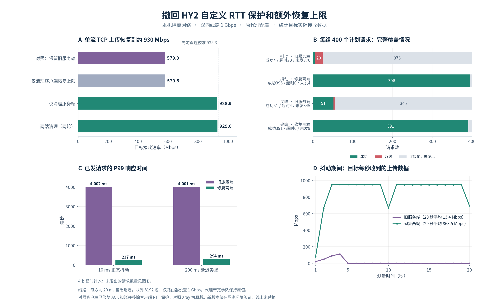

# QUIC BBR 的 ECN 反馈控制（ECN-Aware BBR）

[返回功能目录](../features.md)

在现有 BBR 上接入经过 QUIC 校验的 ACK_ECN 增量，使发送控制可以结合显式拥塞信号，而不仅依赖吞吐、RTT 和丢包。

## 使用方式

在支持 QUIC 参数的 streamSettings 中，使用既有 BBR 配置。例如将以下片段并入 streamSettings：

```json
{
  "finalmask": {
    "quicParams": {
      "congestion": "bbr",
      "bbrProfile": "standard"
    }
  }
}
```

ECN 状态机没有单独的启用字段。HY2 和 XHTTP 的 QUIC 路径使用同一套 BBR 实现时均受影响，不能理解为只修改了 HY2 协议。必须按[构建说明](build-and-patches.md)应用 quic-go 依赖补丁。

## 状态与边界

有效反馈中没有 CE 标记时允许 STARTUP 探测，稳态保留 PROBE_BW 的原有增益周期；首次 CE 冻结当前速率与窗口；连续 CE 结合比例与 EWMA 逐步回缩。安全丢包阈值使用本轮累计丢失，避免大量小回调被逐个忽略。路径迁移时衰减路径模型并重新处理 ECN 状态。

此前额外加入的 RTT 排队保护已撤回。上传时它会压低服务端的反向控制流速率，
使已经生成的 `MAX_STREAM_DATA` 补窗帧长时间等待。当前保留 BBR 自身的
带宽/RTT 模型、DRAIN、PROBE_RTT、丢包恢复与 ECN 控制，不再按 RTT 增量
叠加另一层限速或缩窗。

纯 ACK 绕过 QUIC pacing，也不扣软件 pacer 的数据预算。需要 pacing 的数据和
补窗控制帧仍正常扣账，避免持续 ACK 流量让补窗发送预算永远无法积累。

ECN 不可用或校验失败时回退至原有带宽、RTT 与 loss 控制。它不要求网络一定支持 ECN，也不能据此保证消除拥塞或丢包。

认证及稀疏小请求不构成带宽平台证据。STARTUP 只有真实发送在途数据达到初始
窗口时才累计未增长往返；丢包仍可提前结束探测。
`0010-report-explicit-idle-before-pacing.patch` 在 cwnd/pacing 提前返回之前
检查应用、重传及 DATAGRAM 队列，将真实空闲通知传至 BBR。BBR 直接保留该信号，
避免尾部在途数据隐藏空闲，使随后的小请求错误压低带宽模型。排队或发送受限
本身不会被当作应用空闲。

## 撤回额外的速率恢复上限

此前空闲重启、排空和恢复后的自定义 pacing cap 与每 RTT 最多恢复 25% 的限制
一并删除。实际速率使用 BBR 与 ECN 模型的输出，保留现有 profile 和显式空闲的
sampler 通知，不再保留另一份低速上限。真实丢包的 STARTUP 退出判断仍先于
app-limited 带宽平台判断。

双向 1 Gbps 的隔离线路中，保留原版 Xray 时单流上传约 579 Mbps；清理两端后
两轮为 929.1、930.1 Mbps，下载为 931.5 Mbps。20 秒抖动与延迟尖峰测试中，
修复后已发请求均无超时，仍分别记录 4、9 个未发出的忙碌 tick。仅路由器设置
线路速率，代理带宽参数保持原值；新二进制未替换线上服务。
[原始汇总、消融及验证边界](../benchmarks/hy2-extra-guard-removal-2026-10-18.json)。



[历史源数据、测试及部署记录](../benchmarks/adaptive-upload-burst-2026-10-13.json)
保留原始测量；旧控制器测试仅验证当时预设的限速行为，不能证明正常吞吐没有回退。
源 CSV 的 237 Mbps 单次上传与 1.23 秒负载延迟不能用于定位具体排队点。

## 按接收速率选择 ACK 频率

`0011-adaptive-receiver-ack-policy.patch` 使用每条 QUIC 连接实际接受的、
需要确认的应用数据包长度估算接收速率，包含 QUIC 头和认证开销，不含 IP/UDP 头。
两个加权的 20 ms 桶避免跨桶时速率突然归零；初始样本至少按 1 ms 计算。
低于十进制 100 Mbps 时保持每 2 包确认；达到门槛后，仍须 PMTU 稳定和连续
安静收包，才逐步提高到原有最多每 8 包确认。低速不累计提高批量比例的信用，
该策略不限制发送带宽，也不使用发送端 BBR 的带宽估计代替接收速率。

缺口、迟到包和 ECN-CE 继续立即触发确认，并恢复每 2 包的基准频率。
新缺口即使撞上已排队 ACK 或包计数边界，也会重置后续频率。
空闲无待确认数据时不启动额外 ACK 定时器；仍有尾包待确认时保留既有
`max_ack_delay` / BBR RTT 预算，不为省 ACK 延长尾包等待。
Initial / Handshake 包继续立即确认，纯 ACK 和被拒绝的重复包不计入速率。

两端完整相关测试、race、连接入口回归、逐项消融和隔离 HY2/FQ 传输通过；
Windows、macOS、Android 的 QUIC/ACK handler 编译通过。日本端已部署
`9b86960c-rx100-ack2`（amd64-v4），本机 Mihomo 部署
`6ba9f709-rx100-ack2`（amd64-v3）。实际进程校验与原配置哈希检查通过，
主代理 HTTP 204 及既有 HY2 节点的小请求成功。未做 WAN 上传测速，
真实弱网延迟收益仍需实测。[验证记录与边界](../benchmarks/receiver-ack-policy-2026-10-14.json)。

## Linux 内核定时发送

HY2 入站和出站在安装 BBR 后请求 quic-go 的 FQ EDT 后端：
`SO_TXTIME(CLOCK_MONOTONIC)` 配置 socket 时钟，每数据报携带独立
`SCM_TXTIME`。共享 UDP socket 不设置某个连接的全局速率，各 QUIC 连接
独立根据有效 BBR pacing rate 排程。依赖补丁为
`patches/quic-go/0006-linux-fq-edt-pacing.patch`。

`0007-hy2-bbr-fq-coordination.patch` 完成 BBR、QUIC 反馈与 EDT 调度的联动：

- 就绪时只绕过软件 pacing 预算，仍执行拥塞窗口、放大保护、PTO 和包数量限制。
- 软件与 EDT 使用同一有效速率，移除原来的 64 KiB/s 下限，使低速路径和 ECN 排空可以实际降速。
- 速率变化按上一包大小重算后续间隔；发送线程反馈预约进度，数据积压只限制继续打包数据，ACK/PTO 的发送机会保留。
- 纯 ACK 不消耗 EDT 预约，并保留后续数据的发送机会；BBR 的小窗口配合 `min(25 ms, max(1 ms, RTT/4))` 的 ACK 等待预算。ACK 定时从首个待确认包起算，不被后续包推迟。
- QUIC 无数据可打包时才通知 BBR 应用受限，避免 pacing 或小窗口导致带宽模型误判；控制器替换同步当前 MTU，迁移时重置 MTU、排程与 ACK 抽样状态。
- BBR 的发送前/后在途字节语义、纯丢包恢复、ECN 与 DRAIN/PROBE_RTT/恢复的优先级，以及速率和 BDP 算术均有回归覆盖。

预约提前量不超过 1 ms，每连接最多记录 32 个未来预约，发送线程待处理数据量
按提前量和包间隔进一步限制。内核模式不使用 GSO 大批次，握手、ACK-only、
PTO、PMTU 探测保持既有发送。保留 QUIC 原有入队时间记账，因此 RTT 仍包含
内核排队和发送线程延迟，并非网卡实发时间戳。

Linux（不含 Android）上还会按实际远端、UDP 端口、源地址/接口、socket mark、
网络命名空间进行只读路由与 qdisc 检查。要求出口 root 为启用 pacing 的 `fq`，
或 `mq` 的全部发送队列均为此类 `fq`；未知路由、混合队列与不支持 TXTIME/OOB
的 socket 保留用户态 pacing/GSO。路径变化立即重新检查，路由/qdisc/socket
选项变化最多缓存 5 秒；任意 BPF、nftables 或 TC redirect 后的最终出口仍不能
仅由该查询保证。程序不修改 qdisc。

socket 设置非零 DSCP 且支持 ECN 时也保守回退，因为现有 ECN 控制消息会
覆盖 socket 的 traffic class，此时不能直接用原 DSCP 证明本次发送的出口。

最小 RTT 小于 2 ms 时保留用户态 pacing/GSO，避免 EDT 的提前量及逐包发送
开销影响本地路径。Linux 之外、Android、非 BBR 控制器以及掩码未暴露 OOB 的
socket 也保留原后端。明确的 TXTIME 不兼容写错误或内核时钟读取失败会按
预约时刻使用普通发送并回退。
`QUIC_GO_DISABLE_KERNEL_PACING=1` 可强制保留用户态后端；
`Conn.KernelPacingEnabled()` 提供安全的状态读取，QUIC debug 日志记录 FQ 路径检查。
协议与现有节点兼容，不能保证消除 qdisc 限额、网络拥塞或 HY2 应用 UDP 队列满
造成的丢包。

依赖测试 `TestKernelPacing*` 覆盖时间域转换、共享 socket 控制消息、预约边界、
延迟发送线程与回退。`TestKernelPacingFQIntegration` 读取
`QUIC_KERNEL_PACING_PEER` 指向 UDP echo 接收器，在真实 FQ 环境验证到达间隔。

`0009-linux-fq-edt-batch-cpu.patch` 让就绪批次共享一次时钟校准、复用发送描述符，
批次完成后统一发布预约进度和释放额度。睡眠后重新校准，校准耗时从提前量预算
扣除；每数据报仍保留独立 TXTIME，立即 ACK/PTO、部分写入及回退语义不变。
`BenchmarkKernelPacingReadyBatch` 单独测发送准备成本；其结果不代表整个服务 CPU
或真实网络吞吐。完整 CPU 收益应在固定吞吐和同一客户端条件下另行比较。

执行 `bash scripts/test-hy2-bbr-fq.sh` 可自动应用补丁、检测本机 CPU、构建测试
程序，并在临时网络命名空间中验证 FQ 时间间隔、HY2 认证、PMTU、共享服务端
socket 的双客户端双向传输、短 RTT 回退和非 FQ 回退。测试中可给接收批次增加
5 ms 处理延迟以覆盖 EDT 后端，这属于控制反馈测试，不代表 WAN 吞吐基准。
若运行内核缺少 veth，脚本改用隔离 loopback 并明确报告；退出时清理命名空间。

2026-10-10 本机验证使用 `GOAMD64=v3`：HY2 与 quic-go/ACK handler 完整测试、相关 race
检查通过。隔离 loopback FQ 两路 10 包的接收跨度约为 18/27 ms；双客户端各
4,200,000 字节上行及等量下行校验通过，qdisc 统计无丢包。veth、整服务隔离 CPU
基准和长期公平性仍需在对应环境测量；历史 WAN 的短时对比如下。

## 2026-10-14 CPU 与 RTT 修复验证

就绪 EDT 发送准备的三次基准中位数：

| 每批包数 | 修复前 | 修复后 |
| --- | ---: | ---: |
| 1 | 520 ns | 302 ns |
| 4 | 1,670 ns | 650 ns |
| 8 | 3,287 ns | 1,121 ns |

每批 384 字节、一次分配降至零；时钟校准和完成唤醒改为逐批处理。
这些数据只覆盖 EDT 发送准备，不能当作完整服务 CPU 的降幅。

日本生产服务使用同一测试客户端、原有 HY2/443 和固定下载负载：每轮四次
25,000,000 字节请求，curl 限速 25 MiB/s，各运行三轮。CPU/GiB 中位数
13.31→11.62 秒，吞吐中位数 175.3→177.9 Mbps。计数包括生产后台流量及 SSH
采样路径；重启会重建 QUIC 连接，且此次同时修改了 BBR，不能将约 13% 的差值
全部归因于批处理。首轮较高的 CPU 计数保留，没有排除。此阶段仅测试下载。

当前完整相关包测试、针对改动的 race 检查，以及 HY2 双客户端双向传输通过；
veth 不可用时使用隔离 loopback FQ，未修复宿主环境。Windows amd64-v3、macOS
arm64、Android arm64 的 BBR/HY2/QUIC 交叉构建通过，其他平台未做真实设备测量。

生产服务器已部署 `27808cc7-cpu-rtt-idle` 的 `linux-amd64-v4` 产物，实际进程
二进制校验一致，配置校验通过，服务 active/running、NRestarts 为 0，原端口
HY2 下载检查返回 HTTP 200。原配置哈希保持
`6ea91b8928c1d3e91681d78a2ce83c3ccb3f0bb412cbaf94e55330a12b39796e`。
本机 Mihomo 同期完成空闲通知与原生 FQ 反馈修复，主代理访问检查返回 HTTP 204。
临时测试服务和认证配置已清理，两端旧二进制备份保留。

[逐轮指标、构建校验值和验证限制](../benchmarks/fq-cpu-rtt-2026-10-14.json)。

## 2026-10-10 Mihomo 与日本生产服务器实测

使用原有 HY2/UDP 443 端口，依次运行原生产二进制 `6e8cec40-edt` 和
`hy2-bbr-fq-coordinated`，客户端使用同一版本 Mihomo、认证和 TLS/ECH 配置。
测试源仅监听服务器 `127.0.0.1:28080`，用临时 routing 与 freedom `finalRules`
放行；仅添加 routing 无法覆盖 freedom 的 HY2 私网保护。测试后已恢复原配置。
`scripts/hy2-wan-ab.py` 提供测试源、私有配置准备和重复负载，准备的配置权限为
600，单流下载 16 MiB、上传 8 MiB、四路各下载 4 MiB，每轮另做 12 次 1 KiB 请求。
吞吐包含请求和 curl 进程开销，均校验完整字节数及 HTTP 成功状态。

首轮直接连接的下载中位数为 60.3→473.4 Mbps，反向切换复测则为
275.9→492.1 Mbps，说明连接或时段波动明显，不能将首轮差距全部归因于修复。
为进一步控制路径变化，在本机使用同一个带 routing mark 的 UDP socket
转发 Mihomo 流量，保留每包 ECN traffic class，切换服务器二进制期间保持 socket。
服务器 access 日志确认两版最后 112 个测试请求来自同一个公网 IP/UDP 端口。
这个额外中转用于控制连接变量，其开销同时存在于下列两组数据中。

固定 UDP 出口后三轮中位数：

| 项目 | 修复前 | 修复后 | 变化 |
| --- | ---: | ---: | ---: |
| 单流下载 | 369.5 Mbps | 453.6 Mbps | +22.8% |
| 上传 | 198.6 Mbps | 216.5 Mbps | +9.0% |
| 四流并发下载 | 391.1 Mbps | 591.4 Mbps | +51.2% |
| 小请求首字节 | 74.25 ms | 74.55 ms | 接近 |

[原始逐轮指标与环境摘要](../benchmarks/hy2-bbr-fq-2026-10-10.json)保留 24 项负载结果。
服务器实际出口为 ens5 上的 `mq` 加两路开启 pacing 的 `fq`，horizon 为 10 秒。
修复版 QUIC 日志报告实际 HY2 客户端路径 `ready=true`；测试前后两路 qdisc
累计 dropped 均为 0，本机中转的接收溢出计数也为 0。观察到了 ECT(0)，未观察到
CE，因此此处不能作为真实 WAN 上 CE 回缩效果的证据。CPU 计数包含整个生产
`xray.service` 的其他流量及统计请求间隔，负载较短，不能据此声称 CPU 开销降低。
这些结果用于此次部署判断，不能证明长期公平性或其他网络的收益。

生产服务器 Xeon Platinum 8259CL 已确认支持所需 AVX-512 指令，部署产物使用
`GOAMD64=v4`，命名为 `xray-after-linux-amd64-v4`。最终 `/usr/local/bin/xray`
为修复版，SHA-256 是
`7546db3d4cc023ab507f457f2987810742900f06fdd93444c7d3dbb352dd6396`。
原配置 SHA-256
`6ea91b8928c1d3e91681d78a2ce83c3ccb3f0bb412cbaf94e55330a12b39796e`
已逐字节恢复，服务 active，恢复后 HY2 新连接及本机现有 Mihomo 公网访问均返回
HTTP 204。临时调试配置、服务器测试源和本机测试服务已清理；保留原二进制备份
`/usr/local/bin/xray.pre-hy2-fq-01a12406`，其校验值见原始指标文件。本机现有
Mihomo 服务未重启，当前配置保留。

## 实现与验证入口

- [BBR 状态机](../../transport/internet/hysteria/congestion/bbr/ecn_bbr.go)、[BBR 集成](../../transport/internet/hysteria/congestion/bbr/bbr_sender.go)
- [ECN 回归测试](../../transport/internet/hysteria/congestion/bbr/ecn_bbr_test.go)
- [ACK_ECN 依赖补丁](../../patches/quic-go/0001-hy2-expose-validated-ack-ecn-deltas.patch)
